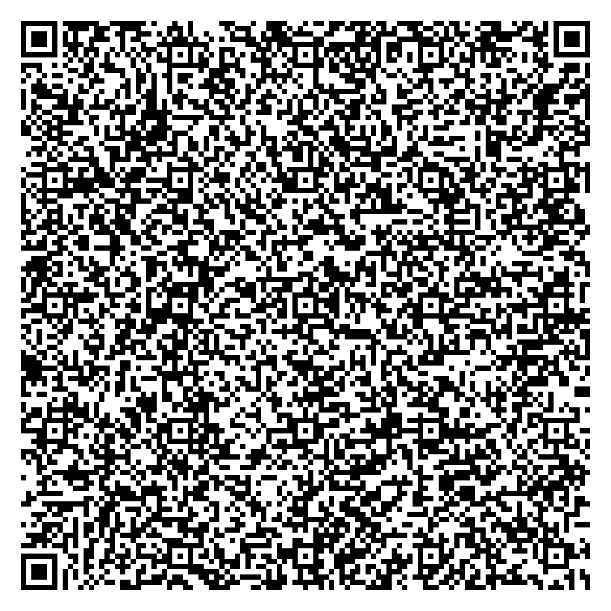
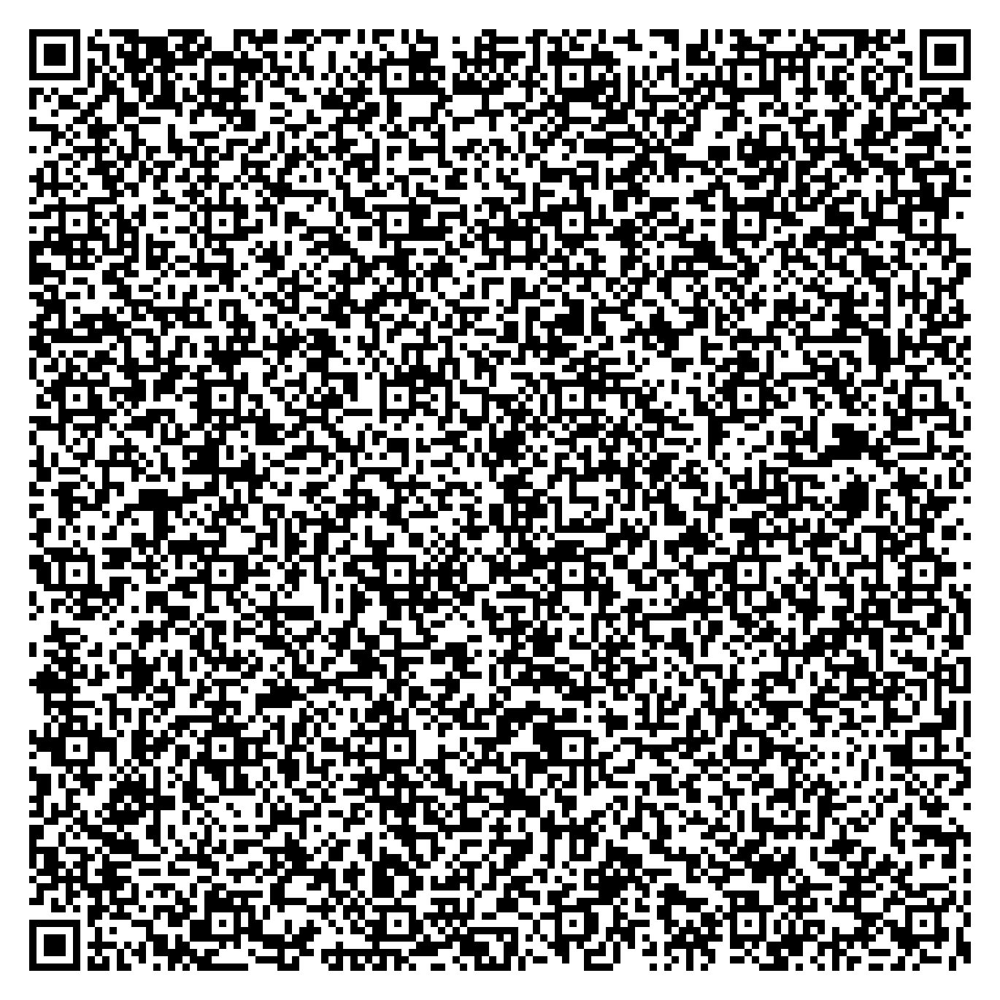

# QR Code to Game

**Play entire HTML games from QR codes — without hosting each game as a separate webpage.**

[**Open the QR game decoder**](https://qr.micahknox.com/)

QR Code to Game compresses standalone HTML/CSS/JavaScript games, converts the compressed bytes into QR-friendly text, and places that text directly in a URL. When someone scans the QR code, the website reads the data from the URL, decompresses the game in their browser, and launches it.

The game is **stored in the QR code itself**; the website supplies the decoder and shared Huffman tree. A connection to the site is required to load the decoder and tree.

## Try the games

**Scan one of these QR codes with your phone** (or open the image and scan it from another device). Each code links to the hosted decoder with a game embedded in its URL.

| Flappy Bird | Snake | Pong |
|:---:|:---:|:---:|
|  |  |  |

| 2048 | Breakout | Minesweeper |
|:---:|:---:|:---:|
|  |  |  |

More QR codes are available in [`Backend/html-games-encoded/`](Backend/html-games-encoded/), including Dino, Doodle, Invaders, and Tower Defence.


## How it works

```text
Standalone HTML game
        │
        ▼
  HTML/CSS/JS minification
        │
        ▼
  Huffman compression
  (bytes or repeated-string tokens)
        │
        ▼
  Base-39 encoding
        │
        ▼
  QR code containing a URL
        │
        ▼
  https://qr.micahknox.com/0/<BASE39_DATA>
        │
        ▼
  Browser fetches shared Huffman tree
        │
        ▼
  Base-39 → Huffman → HTML
        │
        ▼
  Game runs in an iframe
```

The compressed `.huff` format begins with a **4-byte big-endian uncompressed byte length**, followed by Huffman bits packed most-significant-bit first. The length tells the decoder when to stop and ignore padding bits.

### Compression methods

- **Byte Huffman:** Encodes individual byte values (0–255) using a shared tree.
- **Token Huffman (experimental):** Also assigns codes to frequently repeated sequences, such as HTML tags and JavaScript syntax. A generator can compare estimated compressed sizes against the byte-only approach.
- **Base-39:** Converts the binary output to a QR-compatible character alphabet: `0123456789ABCDEFGHIJKLMNOPQRSTUVWXYZ*+-`.

The shared Huffman tree lives outside the QR code, helping keep the encoded URL shorter.

## Project structure

```text
QR-code-to-game/
├── index.html                 # Browser decoder and game player
├── server.py                  # Local development server with /0/ fallback
├── wrangler.jsonc             # Cloudflare Workers static-asset settings (if committed)
└── Backend/
    ├── main.py                # Encoding pipeline orchestrator
    ├── html-encode.py         # HTML minifier
    ├── huffman-tree.py        # Original byte-based tree generator
    ├── huffman-tree-tokens.py # Token tree generator/comparison (if added)
    ├── huffman.py             # Huffman encoder/decoder
    ├── base39.py              # Binary ↔ Base-39 conversion
    ├── qr-generate.py         # QR image generator
    ├── huffman-tree.json      # Shared decoding tree
    ├── html-games/            # Source HTML games
    ├── html-games-condensed/  # Minified games
    ├── html-games-encoded/    # .huff, .txt, and .png outputs
    └── html-games-decoded/    # Optional round-trip verification
```

## Generate a QR code

Requirements: Python 3 and the Python packages used by the project's minifier and QR generator (notably `minify-html` and `qrcode[pil]`).

```bash
python -m pip install minify-html "qrcode[pil]"
```

Run these commands from `Backend/`.

**1. Generate a shared byte-based Huffman tree:**

```bash
python huffman-tree.py html-games-condensed -o huffman-tree.json
```

**2. Encode one game:**

```bash
python main.py flappy-bird.html huffman-tree.json
```

**3. Or encode a folder of games:**

```bash
python main.py html-games huffman-tree.json
```

The pipeline minifies each game, compresses it into a `.huff` file, converts it into a Base-39 `.txt` payload, and generates a `.png` QR code in `html-games-encoded/`.

### Compare token Huffman against byte Huffman

If you have added `huffman-tree-tokens.py`:

```bash
python huffman-tree-tokens.py html-games-condensed \
  -o huffman-tree-tokens.json \
  --baseline huffman-tree-bytes.json
```

This prints per-game estimates and total savings, including the size of the shared tree. **Important:** The token generator and the Python/browser decoders must agree on how string tokens map to bytes. In particular, the current token generator uses Latin-1 to represent arbitrary byte sequences, while an encoder that interprets strings as UTF-8 will not round-trip all tokens correctly. Resolve that mismatch and verify a full encode/decode round trip before publishing token-encoded QR codes.

## Run locally

From the repository root:

```bash
python server.py
```

Then visit `http://localhost:8000/`. A generated game URL can also be tested by replacing `https://qr.micahknox.com` with `http://localhost:8000` while preserving the `/0/<BASE39_DATA>` path.

The custom local server is needed because a plain `python -m http.server` would otherwise return 404 for the encoded `/0/...` paths.

## Cloudflare deployment

This project is deployed as a **Cloudflare Worker with static assets**. The Worker should publish the repository root (the directory containing `index.html`) and use a single-page-application fallback so `/0/...` URLs serve the decoder.

## Limits and compatibility

- QR codes have finite capacity; very large games may not fit. The QR generator uses QR alphanumeric mode with low error correction to maximize available payload space.
- The decoder and encoded game **must use the same Huffman tree**. Replacing the tree can break previously printed QR codes.
- Games should be self-contained HTML files. External assets or browser storage requirements may not work inside the sandboxed iframe.
- These QR codes are meant to be opened as URLs. They are not executable games in a generic offline QR scanner.

## Project goal

Explore how much interactive software can fit inside a QR code using minification, shared dictionaries, Huffman coding, and compact URL encoding.
