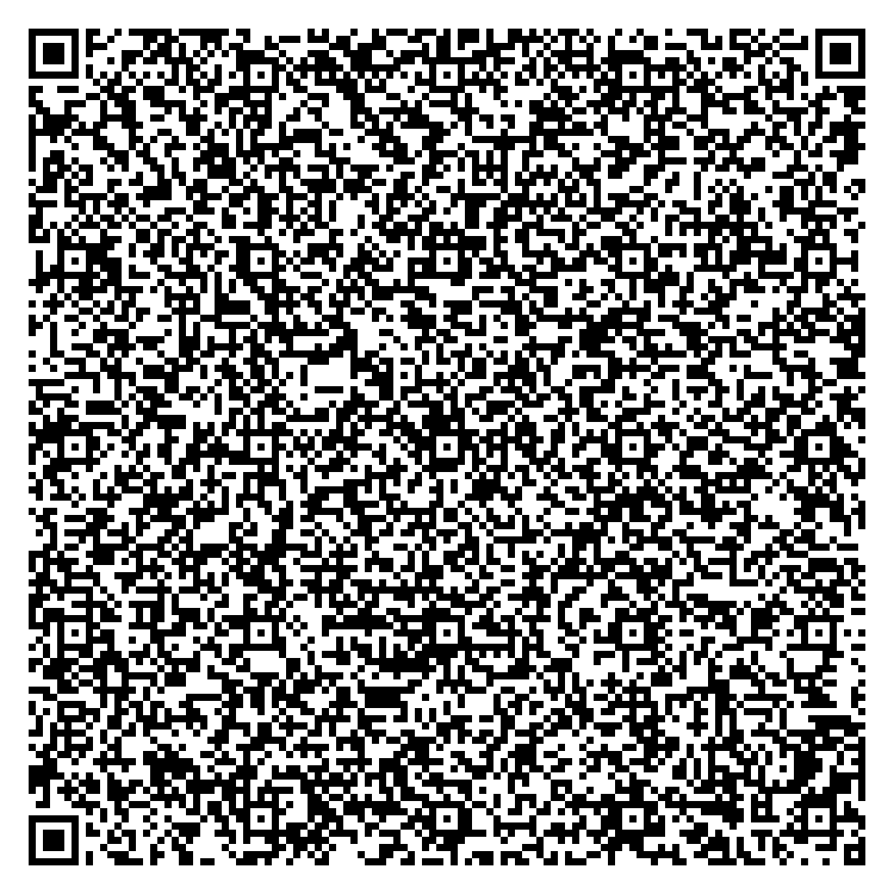
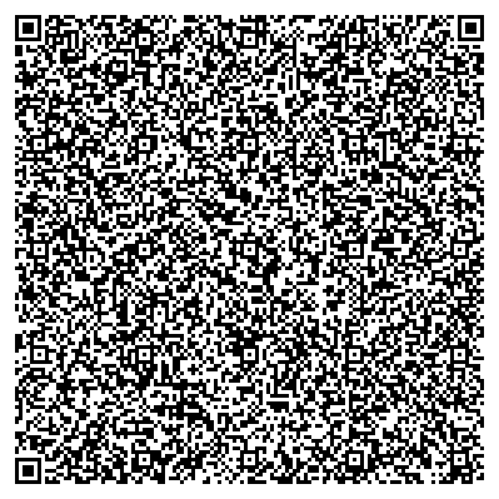

# QR Code to Game

**Play entire standalone HTML games from QR codes without hosting each game as a separate webpage.**

[Open the QR decoder](https://qr.micahknox.com/)

QR Code to Game minifies a self-contained HTML/CSS/JavaScript page, compresses it using a shared Huffman tree, converts the result to QR-friendly Base-39 text, and embeds that text directly in a URL. Scanning the QR code opens a decoder that retrieves the selected tree, reconstructs the page, and runs it in a sandboxed iframe.

**The page data is stored in the QR code itself.** The decoder and Huffman trees are hosted separately, so an internet connection is required to load them.

## Try the games

Scan a QR code with your phone, or open the image on another device and scan it. The examples below use **tree 0**, trained for games.

| Flappy Bird | Snake | Pong |
|:---:|:---:|:---:|
|  |  |  |

| 2048 | Breakout | Minesweeper |
|:---:|:---:|:---:|
|  |  |  |

See [`Backend/html-games-encoded/0/`](Backend/html-games-encoded/0/) for other generated game QR codes. Images render on GitHub only when the corresponding PNG files are committed at these paths.

## How it works

```text
Standalone HTML page
        |
        v
HTML / CSS / JavaScript minification
        |
        v
Huffman compression using a selected shared tree
        |
        v
Base-39 encoding
        |
        v
QR code containing https://qr.micahknox.com/{TREE_ID}/{BASE39_DATA}
        |
        v
Browser reads TREE_ID and fetches /Backend/trees/{TREE_ID}.json
        |
        v
Base-39 decode -> Huffman decode -> HTML
        |
        v
Page runs inside a sandboxed iframe
```

The `.huff` format contains a **4-byte big-endian original byte length** followed by MSB-first Huffman bits, padded to a whole number of bytes. The length lets the decoder ignore trailing padding bits.

### Compression methods

- **Byte Huffman:** Encodes individual byte values (0–255) using a shared tree.
- **Token Huffman (experimental):** Also assigns codes to frequently repeated sequences, such as HTML tags and JavaScript syntax. A generator can compare estimated compressed sizes against the byte-only approach.
- **Base-39:** Converts the binary output to a QR-compatible character alphabet: `0123456789ABCDEFGHIJKLMNOPQRSTUVWXYZ*+-`.

The shared Huffman tree lives outside the QR code, helping keep the encoded URL shorter.

## Project structure

```text
QR-code-to-game/
├── index.html                    # Browser decoder; selects tree from URL
├── server.py                     # Local server with encoded-URL fallback
├── wrangler.jsonc                # Cloudflare static asset configuration, if present
└── Backend/
    ├── main.py                   # Minify -> Huffman -> Base-39 -> QR pipeline
    ├── html-encode.py            # HTML/CSS/JS minifier
    ├── huffman-tree.py           # Original byte-based tree generator
    ├── huffman-tree-tokens.py    # Token tree generator and size comparison
    ├── huffman.py                # Huffman encoder and decoder
    ├── base39.py                 # Binary / Base-39 conversion
    ├── qr-generate.py            # QR image generator
    ├── trees/
    │   ├── 0.json                # Game-optimized tree
    │   └── baseline.json         # Optional byte-only comparison tree
    ├── html-games/               # Original HTML games
    ├── html-games-condensed/     # Minified HTML
    └── html-games-encoded/
        └── 0/                    # Outputs for tree 0
            ├── snake.huff
            ├── snake.txt
            └── snake.png
```

## Generate QR codes

Requires Python 3 and the dependencies used by the minifier and QR generator:

```bash
python -m pip install minify-html "qrcode[pil]"
```

The examples below run from the **repository root**.

### 1. Generate a token Huffman tree

Minify the training pages first if needed. Then generate tree 0 from the minified game files:

```bash
python Backend/huffman-tree-tokens.py html-games-condensed -o trees/0.json
```

The generator resolves the input folder relative to `Backend/` if it does not exist relative to your current directory. It saves `Backend/trees/0.json` and the byte-only comparison tree at `Backend/trees/baseline.json`.

For a different training corpus and tree ID, for example text-heavy HTML:

```bash
python Backend/huffman-tree-tokens.py html-text-condensed -o trees/1.json
```

The generator reports estimated compressed sizes for byte-only and token-based Huffman encoding, including the shared tree size. These are estimates, not guaranteed QR-code lengths.

### 2. Encode one HTML page

```bash
python Backend/main.py Backend/html-games/snake.html Backend/trees/0.json
```

### 3. Or encode an entire folder

```bash
python Backend/main.py Backend/html-games/ Backend/trees/0.json
```

`main.py` automatically reads the tree ID from `0.json`, uses that tree for compression, and creates QR URLs starting with `/0/`. Outputs go to `Backend/html-games-encoded/0/` as `.huff`, `.txt`, and `.png` files.

To use another tree:

```bash
python Backend/main.py Backend/html-text/ Backend/trees/1.json
```

That produces `/1/` URLs and writes files under `Backend/html-games-encoded/1/`.

**Important:** Tree filenames must be numeric (for example `0.json` or `1.json`). The encoder and browser must agree on the token-to-byte representation. Before publishing a new tree, verify that a file survives a complete Huffman encode/decode round trip unchanged.

## Run locally

From the repository root:

```bash
python server.py
```

Open [http://localhost:8000/](http://localhost:8000/). To test a generated URL locally, replace `https://qr.micahknox.com` with `http://localhost:8000` while keeping the `/{TREE_ID}/{BASE39_DATA}` path unchanged.

The local server needs to serve `index.html` for encoded paths such as `/0/...` and `/1/...`, while serving actual JSON files from `/Backend/trees/`.

## Cloudflare deployment

The site uses **Cloudflare Workers static assets**. Publish the repository root so that both `index.html` and `Backend/trees/*.json` are accessible. Configure SPA fallback so URLs such as `/0/...` and `/1/...` load the decoder without replacing the URL path.

Check a tree directly before testing a QR code:

```text
https://qr.micahknox.com/Backend/trees/0.json
```

It should return JSON, **not** the decoder's HTML. If the browser reports `Unexpected token '<'` while parsing a tree, the server likely returned an HTML fallback because the JSON file was missing or the path was wrong.

## Limits and compatibility

- QR codes have finite capacity. Large pages may not fit even after compression; the generator uses QR alphanumeric mode with low error correction to maximize payload size.
- The tree file used for encoding must match the ID embedded in the URL. **Do not overwrite a published tree** unless you also regenerate its QR codes.
- Token trees must use consistent Latin-1 token expansion in Python and JavaScript. The reconstructed HTML is decoded as UTF-8.
- Pages should be self-contained. External assets, network access, and browser storage may not work as expected inside the sandboxed iframe.
- These QR codes contain URLs and require the hosted decoder; they are not independently executable offline.

## Project goal

Explore how much interactive software and other self-contained HTML content can fit into a QR code using minification, reusable compression dictionaries, Huffman coding, and compact URL encoding.
